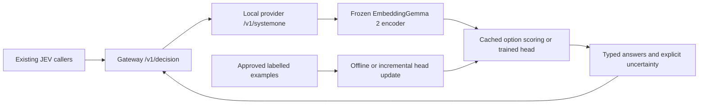

# EmbeddingGemma 2 as a local System One engine

Investigated 28 October 2026 (Australia/Melbourne). Owner: Tony; investigator: Codie, working solo.
Canonical tracker: [epic #10](https://github.com/Holovkat/jev-mark/issues/10).
Discovery: [#11](https://github.com/Holovkat/jev-mark/issues/11); runtime spike: [#12](https://github.com/Holovkat/jev-mark/issues/12); learning: [#13](https://github.com/Holovkat/jev-mark/issues/13); combined verification: [#14](https://github.com/Holovkat/jev-mark/issues/14).

## Decision now

**Proceed to a bounded feasibility spike.** The model and an existing decision harness make this a credible local option for intent routing, classification, semantic selection and coarse image decisions. Local endpoint latency, calibrated reliability and useful online learning remain unproven here. Do not replace the current engine based on the social demo.

The smallest candidate is a persistent EmbeddingGemma encoder plus cached option representations and a typed decision adapter, registered through the existing System One profile mechanism. First assess Google's MediaPipe/LiteRT C API on macOS; avoid writing another scoring framework before checking it. Keep the encoder frozen for initial online-learning experiments.

This turn completed research, live source/runtime inventory and epic creation. It did not install models, build an endpoint, run inference benchmarks, alter providers, train anything, call a teacher, commit or push.

## What the post establishes

Tony supplied [Matt Mastracci's post](https://x.com/mmastrac/status/2115098609356284223), dated 27 October 2026, 15:09 UTC. Direct X access returned 403; the public FxTwitter mirror returned the matching author/text and media. The post claims approximately 20 ms text, 100 ms images, online trainability and upstream-teacher distillation.

I inspected its thumbnail, not the entire video. The frame displays **8.5 fps, 110 ms per frame (EG2, CPU, every question)**, two question panels, 419/427 labelled frames and “student weight 98%”. That last number is not an accuracy result. Its precise algorithmic meaning is unverified. The frame demonstrates the UI of a live learning/classification system, not a held-out quality benchmark.

The post has no source link. The author's inspected [djev](https://github.com/mmastrac/djev) and [djev-spark](https://github.com/mmastrac/djev-spark) documentation describes the earlier DiffusionGemma stack. Its DGX Spark hardware and timing cannot be assigned to this new EmbeddingGemma demo. The new harness implementation, CPU model, cache state, input lengths, image settings and teacher protocol were not found in the checked sources.

Local evidence: [post metadata](../output/embeddinggemma2-investigation/post-source.json) and [inspected thumbnail](../output/embeddinggemma2-investigation/post-thumbnail.jpg).

## Model identity and size

The model is **google/embeddinggemma-2**, distinct from Gemma 2 and the hosted Gemini Embedding 2 API. Google released it on 6 October 2026. It maps text/code, images, audio and video into one embedding space. The modular sizes are approximately 270M text, 440M text/vision and 740M full multimodal. Output is 768 dimensions, with supported 512/256/128-dimensional truncation, and the model context is 8,192 tokens. Licence: Apache 2.0. These facts describe the encoder; they do not supply a System One HTTP server or prove decision quality. [Google model card](https://ai.google.dev/gemma/docs/embeddinggemma/model_card_2), [launch](https://blog.google/innovation-and-ai/technology/developers-tools/embeddinggemma-2/).

For a reference implementation, use the documented classification prefix symmetrically, normalize vectors, and renormalize any truncated vectors. Start at 768d; smaller vectors primarily reduce storage/scoring work, not the encoder's forward-pass cost. Google's reference warns against float16 inference; use supported bfloat16/float32 or a validated quantized runtime. [Model numerical and representation guidance](https://ai.google.dev/gemma/docs/embeddinggemma/model_card_2).

The official developer guide provides SentenceTransformers multimodal inputs and selective loading. A text/image experiment can omit the audio tower. This is an alternative correctness reference, not a prediction of Mac performance. [Developer guide](https://developers.googleblog.com/embeddinggemma-2-the-developer-guide/).

## Speed: promising, with different measurement boundaries

The LiteRT text/vision release publishes:

| Platform/backend | Text | Text + vision |
| --- | ---: | ---: |
| MacBook Pro M5 CPU | 31.3 ms | 151 ms |
| MacBook Pro M5 GPU | 9.5 ms | 37.3 ms |

These are averages of five iterations using a 128-token text signature and 70-token vision signature. The table is not an end-to-end System One gateway benchmark or an M1 Ultra result. The quantized text/vision artifact is approximately 388 MB. [LiteRT artifact and measurement method](https://huggingface.co/litert-community/embeddinggemma-2-text-vision-440m-litert-lm).

An independent author's Node/ONNX CPU implementation reports roughly 168 ms median per single-text embedding and explicitly limits its tiny curated quality set. This illustrates how much the runtime matters; it is not a comparable head-to-head test. [Author's implementation and benchmark](https://github.com/karimtn/embeddingGemma2-jeff).

The current host reports **Apple M1 Ultra, 64 GiB RAM**. Neither the post nor the M5 measurements establish what this host will achieve. Loading, tokenization, image decoding, option embedding, calibration, serialization, queueing and the JEV gateway all need separate timing.

## Existing harnesses and the important API gap

Google's Decision Maker already exposes Choice, Boolean and rubric Score concepts, prewarming and structured JSON integration. It documents an embedding backend which scores input against precomputed option representations. This is the most relevant reuse candidate. [Decision Maker overview](https://developers.google.com/edge/mediapipe/solutions/decision/decision_maker).

However, inspected **MediaPipe v1.1.1**, commit `50505c8312c7eacb1bd411cecdc4cc9fd08d53cb`, shows:

| Surface | Source observation | Consequence |
| --- | --- | --- |
| Python Decision Maker | `DecisionContext` contains text; public evaluation methods accept strings. No public multimodal-context or JSON evaluation method was found in this wrapper. | Do not assume the overview's multimodal claims are available through these Python methods. |
| C Decision Maker | `MpDecisionContext` has text, one image buffer and audio; `EvaluateContextJson` and typed context methods are declared. | Plausible image route: macOS arm64 exports verified below; model execution remains untested. |
| Swift package | Manifest declares iOS 15 and prebuilt frameworks. | An iOS guide does not prove macOS app integration; inspect binary slices before selecting it. |
| Distribution | PyPI lists a macOS arm64 MediaPipe 1.1.1 wheel. | Wheel checksum, arm64 library and C exports verified; loading models and GPU delegation remain untested. |

Sources: [Python wrapper](https://github.com/google-ai-edge/mediapipe/blob/v1.1.1/mediapipe/tasks/python/decision/decision_maker.py), [C header](https://github.com/google-ai-edge/mediapipe/blob/v1.1.1/mediapipe/tasks/c/decision/decision_maker/decision_maker.h), [package manifest](https://github.com/google-ai-edge/mediapipe/blob/v1.1.1/Package.swift), [PyPI metadata](https://pypi.org/pypi/mediapipe/1.1.1/json).

I downloaded the 37.2 MB macOS wheel for static inspection, verified its PyPI SHA-256, and inspected its arm64 Mach-O library without installing or executing it. It exports `MpDecisionMakerEvaluateContextJson`, all typed context evaluation functions, schema prewarm and image/audio UniversalEmbedder functions. This resolves symbol availability, not successful model loading or inference. [Static inspection receipt](../output/embeddinggemma2-investigation/mediapipe-wheel-inspection.json).

The C image buffer does not establish JEV's multiple-image/inline-placement semantics. Prove that mapping or reject unsupported combinations. The documentation also uses differing context defaults/examples; model capacity must not be advertised as the chosen harness limit without measurement.

Upstream llama.cpp has an EmbeddingGemma 2 architecture, but its documented System One route is for supported decision architectures. Loading an embedding model does not establish native System One scoring. The project's custom runtime source lacks this architecture and has uncommitted decision fixes. An upstream upgrade is separate work, not a safe prerequisite to assume. [Upstream encoder](https://github.com/ggml-org/llama.cpp/blob/master/src/models/gemma-embedding2.cpp), [server contract](https://github.com/ggml-org/llama.cpp/blob/master/tools/server/README.md).

## Integration with this project

The app project named jev-llm-prefill resolves to `/Volumes/Seagate/workspace/jev-mark`; the turn's original directory no longer exists. Current branch is `codex/proxy-batching`, HEAD `960060375e4bb5c74fb8113c1ae1a3306503c86d`, with substantial pre-existing changes. No repository/ancestor AGENTS.md was found; the supplied and global owner guidance applies.

Live read-only checks: gateway `:8096/health` is healthy with the existing remote Mercury Decide profile; local Ollama lists no embedding model. The inspected system Python lacks MediaPipe, SentenceTransformers, Transformers, MLX and Torch. This is not an exhaustive scan of other environments.

Proposed flow:

Reuse `scripts/jev_gateway.py` profile normalization, `scripts/jev_images.py` assets, and `scripts/jev_benchmarks.py` frozen jobs. No new user-facing inference API is needed.

| Contract | Required mapping |
| --- | --- |
| Request | Preserve `model`, `state`, question IDs, instructions and criteria; gateway already converts contexts/schema. |
| Choice | Exact option key, complete normalized probabilities and finite confidence; preserve opaque labels separately from descriptions. |
| Score | Existing zero-based rubric indices; expected score, complete probabilities, legend and confidence. Do not silently adopt a different scale. |
| Noul | Probability of true in `noul`; preserve negative examples and explicit true/false criteria. |
| Images | Existing UUID-referenced PNG/JPEG `assets`; preserve reference order/placement or return an explicit unsupported error. |
| Other inputs | Reject unsupported Box/audio/video, invalid assets and over-budget input explicitly. No silent truncation, caption substitution or cloud fallback. |
| Cache | Bound by size; key on model/encoder, schema, instructions, preprocessing, dimension and learned-head revision. A schema change must invalidate relevant entries. |
| Learning | Separate update/version lifecycle from inference; publish head revisions atomically and retain rollback. |

Similarity softmax is an estimated distribution, not automatically a calibrated probability. Keep its provenance visible. The current benchmark runner only resolves model digests for Ollama; an EG2 manifest must also pin its weights, runtime and head rather than relying on a mutable model name.

The existing [benchmark design](benchmark-portal.md), [multimodal contract](multimodal.md) and [Liquid D1 lifecycle precedent](liquid-d1-local.md) supply the native integration patterns. Benchmark epic #4 remains open; using its runner does not close its verification #8.

## Real-time learning and distillation

These are **proposed mechanisms**, not a reconstruction of the unpublished demo:

| Mechanism | What changes | Interpretation |
| --- | --- | --- |
| Label/exemplar updates | Store new labelled embeddings; update prototypes or nearest-neighbour examples. | Fast adaptation without changing encoder weights. |
| Small decision head | Incrementally fit a linear/bilinear or small neural scorer on frozen features. | Low-cost online parameter learning; schema and task generalization still need evaluation. |
| Encoder fine-tuning | Change the text/multimodal representation itself. | More expensive training; invalidate cached embeddings and reassess cross-modal alignment. |

For a teacher experiment, retain input, exact schema, teacher revision and either hard labels or full soft distributions. Fit the student head with supervised loss or distribution matching; compare against untouched zero-shot and exemplar baselines. Use a replay set to detect forgetting, separate calibration data, and split images by scene/session to avoid adjacent-frame leakage. Measure update latency and inference contention. A teacher can be wrong: test against independently labelled holdout data.

Start with frozen encoder + examples/head. Do not run teacher requests implicitly on normal user traffic. Existing accepted data or an explicitly selected teacher/data/budget is needed for a live distillation run. Inference can remain wholly local even when training labels were obtained elsewhere.

As supporting evidence, the independent Reflex experiment fine-tunes the text encoder plus a small head and publishes both gains and regressions. Its author says its promotion checks did not all pass and its probabilities are not generally calibrated; it also warns against substituting its text tower into the original multimodal model. This supports feasibility, not a proven universal recipe. [Reflex model and limitations](https://huggingface.co/Nurymanau/EmbeddingGemma2-Reflex).

## Quality risks and evaluation design

Embedding similarity is most promising when the categories are semantically distinct. Negation, numeric comparisons, new policies, exceptions and missing valid choices can defeat a similarity classifier. Google's own guide distinguishes this from more compositional decision backends and discusses schema descriptions, calibration and abstention. [Decision Maker design guidance](https://developers.google.com/edge/mediapipe/solutions/decision/decision_maker/best-practices).

Do not rewrite or simplify native benchmark questions to make the model look stronger. If a task needs adapted descriptions, record a separate adapted protocol. The existing 77/151-option intent cohorts must retain their full option sets. Calibration/learning must never consume final test rows.

Proposed measurement plan, owned by #14:

- Freeze model/runtime/quantization/head, dataset/scorer/cohort hashes and machine conditions. Keep direct runtime, System One HTTP and shared gateway measurements separate.
- Measure cold loading, new-schema compilation and warm cached schemas; use varied unseen states so an answer cache cannot dominate. Record text length, number of questions/options and image dimensions/token budget.
- Run at least 200 varied warm requests per condition, with recorded warmup and cold samples; test concurrency 1 and 4. Report p50/p95/p99, throughput, memory and failures/timeouts, not just averages.
- Compare identical supported intent/retrieval, logical-adversarial and image cohorts against a frozen existing local profile. Hosted references require separately authorized traffic and retain network/serving differences.
- Measure task accuracy or native macro-F1, Brier/NLL/ECE, and accuracy versus answered coverage under abstention. Select thresholds on calibration data only.
- Compare learning candidates on the same untouched holdout, including before/after accuracy, cross-modal regression, teacher disagreement, update cost, concurrent reads and rollback.

The claimed 20/100 ms are investigation targets, not accepted SLAs. A fast but confidently wrong engine is not a successful replacement. An appropriate first outcome may be a restricted routing/classification provider, with harder cases explicitly left to the existing decision engine.

## Requirement and scenario register

R1–R3 derive directly from the request's model, endpoint, multimodal and learning claims. R4 is the proposed measurement method needed to judge “very fast/suitable”; it is not an owner-specified benchmark budget. R5 records the requested investigation result. Scope is discovery complete, feasibility work proposed; no implementation-readiness or Dev-UAT claim is made.

| ID | Requirement/scenario | Work task | Final evidence |
| --- | --- | --- | --- |
| R1 / EG2-01 | Model/post identity, source limits, runtime/weights | #11, #12 | Sources observed; inference not_run |
| R2 / EG2-02 | Choice/Score/Noul and exact response semantics | #12 | not_run |
| R2 / EG2-03 | Images, placement, unsupported media and context limits | #12 | Source gap observed; runtime not_run |
| R2 / EG2-04 | Schema variation, label order, cache invalidation | #12 | not_run |
| R4 / EG2-05 | Task accuracy, adversarial inputs, OOD/no-valid-option | #12 | not_run |
| R4 / EG2-06 | Calibration and abstention | #12, #13 | not_run |
| R4 / EG2-07 | Cold/warm complete latency, load, memory | #12 | External observations only; local not_run |
| R3 / EG2-08 | Online updates, teacher labels, regression and rollback | #13 | Method assessed; experiment not_run |
| R5 / EG2-09 | Local-only lifecycle, integration safety and adoption decision | #12 | Provisional pilot recommendation; final decision pending |

Exactly one final verification task, #14, follows #11–#13 and covers EG2-01–EG2-09 before any owner Dev UAT. Research closure is separate from implementation, measured verification and owner acceptance.

## Pinned discovery inputs and next action

- Google model revision: `914f7f89142e33e77833254d9c9b90c3cef7303b`.
- LiteRT text/vision revision: `e301f74d5551b0c2641bd5cb4652a76239d5c5f8`; generic file `embeddinggemma-2-text-vision-440m.litertlm`. Device-specific Tensor/Qualcomm variants are not the Mac candidate.
- MediaPipe tag/commit: v1.1.1 / `50505c8312c7eacb1bd411cecdc4cc9fd08d53cb`.
- Python wrapper blob: `7d7c2750fd5538a5bfeddc25e04a139c2b4f71e5`; C header blob: `481bb180408c782787ee1659d13902643eb99bce`.
- Local custom llama.cpp HEAD: `14d04e755fa28653e87b9a07072892265bdc0fad`, with existing dirty decision files.
- Read-only package registry observations: MediaPipe 1.1.1, SentenceTransformers 6.2.0, Transformers 5.21.0; not installed by this investigation.

**Next executable action:** #12 starts from the now-verified macOS arm64 C symbols. Resolve model loading, precision and the finite text/single-image smoke contract, then assess a minimal local System One adapter. Model execution and any multi-image mapping remain unproven. If that route is unavailable, use the official reference to establish text/image correctness and record the runtime tradeoff. Review the resulting finite spike scope through Yiddiy planning readiness before implementation handoff.

Outstanding unknowns: the author's new harness/training method; M1 Ultra end-to-end performance; confidence calibration on our tasks; useful learning sample size; multi-image C API mapping; macOS model execution and GPU support (binary symbols are verified). None is disguised as a passing result.
