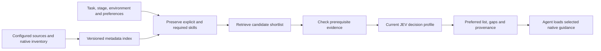

# JEV Skills: central catalogue and task recommendations

Design draft · 17 October 2026. This proposes the UI and API; it does not change
the running app, install skills, or establish accepted implementation scope.

Open the [interactive UI proposal](prototypes/skills.html). Its decisions and
controls are examples; it makes no service requests or preference-file changes.

Prototype review: browser interaction checks covered recommendation tabs and
keyboard navigation, evidence inspection, catalogue search/group/empty states,
preference and bundle previews, session-identity gating, inventory gaps, API
request form state and the native-menu shortcut. All four views fit a 390px
viewport without document overflow; the desktop layout was inspected at 1512px.
No page JavaScript errors or live gateway/API requests were observed. Screenshots
and the temporary browser-check script are under `output/playwright/`.

## Outcome

An agent asks, “Which skills should I use for this task, in this project and
environment?” JEV returns a small preferred list, the evidence for each choice,
and any missing prerequisites. The operator manages sources and preferences
from a **Skills** page opened by the menu-bar app.

Use one recommendation service behind the existing gateway. Extend the existing
`yiddiy:skills-help` CLI/skill and `yiddiy:jev-capabilities` adapters to consume it. A plugin
or MCP tool can later wrap that same contract; another selection engine or a new
hook is unnecessary.

## What is already here

Checked against the working tree and installed gateway on 17 October:

| Existing component | Reuse / gap |
| --- | --- |
| `scripts/capability_selector.py` | Finite relevance decisions, mandatory/explicit preservation, dependency closure, source hashes, cache, abstention and fallback. Currently evaluates candidates in sequential batches of up to 64 contexts. |
| `integrations/capabilities/hook.py`, `integrations/pi/jev-capabilities.ts` | Existing Codex, Claude, Pi and ZCode adapters. Filesystem inventory explicitly reports partial coverage. |
| Distro `/Volumes/Seagate/workspace/agent-skill-distro/plugins/yiddiy/skills/skills-help/scripts/skills.py` | Catalogue, metadata search, classifications, named bundles, session/project selection. Decision mode currently classifies the scoped catalogue rather than retrieving a bounded shortlist. |
| Distro `config/skill-library.json` | Existing editable groups; extend this source for curated recommendation metadata instead of adding a second classification registry. |
| `scripts/skill_preferences.py` | Session preference overrides project default; explicit open, soft selection and stale-selection fallback already exist. |
| `scripts/jev_service.py` | Gateway routes, static assets, request observation and protected local administration patterns. No skills HTTP API currently exists. |
| `Sources/JevMenuBar/main.swift` | Native service and provider controls. Browser portal is the appropriate surface for a large catalogue. |
| `Resources/Web/analytics-portal.js` | Existing portal navigation and visual tokens. Add Skills here when implementing. |

The existing `skills-help ... list --all --json` returned **235 entries** in this
Codex/project scope: 228 filesystem-discovered entries and 7 other maintained
variants. It reports a partial catalogue. These are neither 235 proven-usable
skills nor proof that the owner's 800+ sources have been fully discovered.
Unresolved plugin versions and unregistered sources must remain visible.

`GET /health` returned `status: ok`, with the Mercury Decide route configured.
This proves gateway availability/configuration, not a successful decision run.
The current branch and designs checkout both contain existing unrelated changes.
This proposal adds documents only; those changes are retained.

## Ownership and sources

The requested designs repository exists here at
`/Volumes/Seagate/workspace/designs` (also accessible via the user's workspace
path); `/workspaces/designs` is not present on this Mac. Store a configured
location, not a hardcoded machine path.

Preserve the already-documented ownership model:

- **designs:** reusable workflow content authored there, and its mapped source
  relationships. Its `knowledge/decisions/skill-canonicalisation.md` and
  `knowledge/process/skill-distribution-sync.md` define the existing boundary.
- **agent-skill-distro:** distribution policy, curated groups, adapters, source
  mappings, auditing and installed-root refresh. Distro-native and plugin skills
  do not need duplicate copies in designs.
- **Project and native harness:** local requirements, actual available skills,
  plugin state, tools and overrides.
- **JEV:** a derived, versioned metadata index and task decisions. It does not
  become another editable copy of skill bodies or distribution policy.

Configure designs, distro and known project roots in **Sources**. Merge native
inventory and enabled plugin metadata from adapters. Do not scan every cached
plugin or every disk directory. Aliases to one resolved source collapse; genuine
variants retain qualified IDs, origin, content hash and harness binding.
Show source freshness, indexed count, ignored/invalid entries and coverage gaps.
Indexing reads local sources; refresh never runs Git pull or skill installers.

## Decision flow



1. Resolve the registered project, effective session/project preferences and
   project `.jev/capabilities.json`. Stage rules apply only to an explicit stage.
   Preserve explicit requests and required skills before optional retrieval.
2. Read the cached metadata index. Start with the existing keyword/group search,
   enhanced with curated aliases and task tags. A proposed default shortlist is
   48 optional candidates, configurable after measurement. Always add required,
   explicit and known dependency candidates outside that budget.
3. Mark feasibility from current evidence: harness visibility, platform, required
   tools/connectors and source readability. Missing metadata or incomplete native
   inventory yields **unknown**, never an invented pass. Metadata needs gradual
   curation; do not demand manual annotations for 800 skills before the first UI.
4. Ask the current decision model for bounded **appropriateness** labels:
   `use_now`, `available_later`, `not_relevant`, `abstain`. Add finite reason codes
   such as `task_match`, `stage_match`, `domain_match`, `prerequisite_unknown`,
   `later_stage`, `insufficient_evidence`. Render explanations from those codes
   and local evidence. No separate prose-generation model is needed.
5. Combine those labels with independent feasibility:
   `ready`, `blocked`, `unknown`. A model cannot override a missing tool, source
   mismatch, native override or required project policy. Required-but-blocked
   skills stay visible as unresolved requirements.
6. Return required/explicit guidance and its dependencies, then optional usable
   `use_now` skills, then clearly separated unknown/blocked and later-stage rows.
   Break ties deterministically with curated preference, retrieval score and
   qualified ID. The public limit applies to optional results; it never silently
   drops mandatory guidance. Include model abstentions and retrieval exclusions.

The shortlist is a performance mechanism, not a claim of exhaustive judgment.
Return indexed/retrieved/evaluated/returned counts, inventory completeness and
retrieval strategy. An empty match means no candidates found, not “no appropriate
skill exists.” Offer a wider search or group selection. The combined verification
task must measure recall against known tasks before enabling shortlist retrieval
in the existing automatic hooks. Defer embeddings until measured misses justify
their maintenance and runtime cost.

Only scrubbed task text and bounded candidate metadata reach the decision route.
Source paths, skill bodies, credentials, session identity and hashes stay local.
Treat descriptions and task strings as quoted data. Load a selected skill's body
through native discovery when needed; loading guidance grants no action authority.

## UI

### macOS menu bar

Keep provider selection and service controls in the existing popup. Add one
**Skills…** link to `/skills`, beside access to the existing portal. Do not put
the entire catalogue into the popup or add a separate Skills model selector.
The portal shows the active model using existing administrative health metadata.

### Portal → Skills

Reuse JEV's dark panels, blue actions, sidebar and service-status placement.
Four views share one page:

| View | Behavior |
| --- | --- |
| Recommend | Task question, registered project, harness and optional stage. Run explicitly; show required guidance, preferred list, feasibility and unknowns. Inspect one row's evidence, source and decision label. |
| Catalogue | Metadata search, group/source/harness filters, stable IDs and coverage status. Search works while the model is unavailable. |
| Preferences | Review effective session and project choices; reuse existing named bundles. Saving a bundle does not activate it. Session changes require a real native session identity; the browser cannot guess the agent's session. |
| Sources | Configure canonical source roots with a native folder picker; inspect freshness and gaps; explicitly refresh the index. Repo and source management stays local. |

“Use for this session” writes the existing soft-selection format only after
showing the target project, harness, session and resulting required-skill
expansion. “Make project default” is a separate explicit action. Session open
continues to override a project preference. Explain **applies next prompt**;
do not imply already-loaded guidance can be removed.

If the browser was not opened from an identified agent session, offer **Copy
agent instruction** or **Make project default** for a registered project; disable
session apply. An agent CLI may open the page with a short-lived opaque context
handle bound to the session. Do not put paths, raw session IDs or bearer secrets
into the URL.

Loading, no match, partial catalogue, unknown feasibility, source drift, model
abstention and unavailable service get explicit states. A model outage may show
metadata matches labelled **Unjudged**; it must not present them as preferred
model results. All primary controls support keyboard access, and evidence is
available without relying on colour or hover.

## API proposal

Add domain routes to `jev_service.py`, implemented by a small shared service
module. Keep `/v1/decision` and the selector's current packet/result contract
compatible. The new service can map richer assessments into legacy hook advice;
do not silently add fields to the current exact-shape response parser.

| Route | Purpose |
| --- | --- |
| `GET /v1/skills/catalogue` | Paginated local metadata, filters, source/index revisions, freshness and completeness. |
| `POST /v1/skills/recommend` | Stateless task recommendation using the effective preferences and current JEV profile. |
| `GET /v1/skills/preferences` | Effective and underlying session/project choices for a registered context. |
| `PUT /v1/skills/preferences` | Explicit soft/open choice using the existing preference writer and version checks. |
| `GET /v1/skills/bundles`, `PUT /v1/skills/bundles/{name}` | Existing named bundle read/save semantics; no implicit activation. |
| `GET /v1/skills/sources`, `PUT /v1/skills/sources/{id}` | Local source configuration and status; native folder selection registers roots. |
| `POST /v1/skills/catalogue/refresh` | Rebuild the derived index from registered sources; no distribution changes. |

Example proposed request:

```json
{
  "version": 1,
  "task": {
    "request": "Design a central skill recommendation API and its menu-bar UI",
    "stage": "planning"
  },
  "context": {"project_id": "jev-mark", "harness": "codex"},
  "environment": {"platform": "macos", "tools": [], "inventory_complete": false},
  "respect_preferences": true,
  "explicit_skills": [],
  "max_optional_results": 5
}
```

No model/provider parameter. Preferences apply by default; an explicit
`respect_preferences: false` explores the broader catalogue for this request
without changing saved preferences or required guidance.
An absent tool or connector inventory is unknown;
an explicit complete inventory can establish a missing prerequisite. A session
context handle and native inventory revision can be supplied by an adapter.
Caller-supplied availability evidence remains attributed and time-bounded.

Example response shape (illustrative values):

```json
{
  "version": 1,
  "request_id": "skills-example-01",
  "status": "partial",
  "native_discovery": true,
  "catalogue": {
    "revision": "catalogue-revision",
    "complete": false,
    "indexed": 235,
    "retrieved": 48,
    "evaluated": 48,
    "retrieval": "metadata-v1"
  },
  "decision_profile_revision": "opaque-route-revision",
  "preference_revision": "opaque-preference-revision",
  "required": [],
  "preferred": [{
    "skill_id": "distro:shared/skills/plan",
    "name": "plan",
    "appropriateness": "use_now",
    "feasibility": "ready",
    "reason_codes": ["task_match", "stage_match"],
    "evidence_refs": ["native-inventory:example", "source:example"],
    "source_ref": "distro:/Volumes/Seagate/workspace/agent-skill-distro/plugins/yiddiy/skills/plan/SKILL.md"
  }],
  "unresolved": [],
  "later": [],
  "warnings": ["partial_inventory"],
  "elapsed_ms": 0,
  "cached": false
}
```

Stable source IDs must resolve through a machine-local binding, not encode a
caller-controlled path. Return `ok`, `partial`, `fallback` or `no_match` with
finite reason codes; a recommendation result never represents action approval.
Malformed input is 400, unknown registered context/source is 404, stale write or
changed decision route is 409, and local admission limits are 429. An unavailable
model can return a labelled fallback result retaining metadata/native discovery;
an unreadable catalogue returns 503. An exhausted deadline is fallback/partial,
with unevaluated rows explicit, never a successful complete assessment.

### Boundaries, concurrency and caching

First cut assumes agents and UI on this Mac. Protect **all** skills data and
mutation routes with loopback-peer, Host and same-origin checks, adapting the
service's existing administration checks. Do not inherit the unauthenticated
LAN accessibility of `/v1/decision`. A later shared-machine service requires
authenticated access and client-local path resolution as a separate design.

Register project/source roots locally; API callers reference IDs. Validate resolved
paths and symlink destinations against registered sources before reading or hashing.
Do not accept arbitrary paths, shell commands, Git URLs or installer arguments.
Preference writes use atomic replacement, restrictive local permissions and an
expected revision; reject stale writes and unresolvable/ambiguous members.

Capture one immutable internal decision-profile snapshot per run. Reuse the
gateway dispatch, limits and telemetry against that snapshot; do not let batches
mix models when the operator changes providers. If the dispatch cannot honor
the snapshot, stop with `decision_route_changed` and discard the combined
judgment. Expose an opaque revision to callers; the operator UI can still show
the profile name through the existing administration surface.

Cache keys include task/stage, policy, preferences, catalogue/content hashes,
environment evidence, selector/retrieval versions and the resolved profile
revision. The existing selector cache key includes the gateway URL but not the
active profile, so this needs an explicit correction for model-current advice.
Changed source bytes invalidate reuse; re-audit returned bindings before loading.
Do not cache outages, abstentions or unresolved evaluations as successful results.
Use existing observation labels for skill-selection latency/cache/fallback and
counts; keep local raw payload retention under the existing analytics policy.

Use an initial 15-second total recommendation budget and a small bounded service
queue; enforce the stricter caller/hook deadline where applicable. These are
proposed values to measure. No unbounded fan-out, automatic retries or background
provider calls on page load. Keep catalogue browsing independent of model health.

## Implementation sequence

One serial feature slice; no agents, installation, hosted deployment, commit or
push is requested by this design task.

| Task | Goal and acceptance | Files / dependencies / narrow checks |
| --- | --- | --- |
| 1. Catalogue service | Reuse native/distro inventory and groups; stable qualified source IDs; registered roots; atomic index revision; visible missing-source/plugin gaps. No body copies. | New `scripts/jev_skills.py`; factor reusable catalogue operations out of distro `skills-help/scripts/skills.py` after reviewing that repo's instructions. Read-only inventory diagnostic and Python compile. |
| 2. Recommendation API | Bounded retrieval plus preserved explicit/required/dependency closure; separate feasibility; active-profile snapshot/cache invalidation; protected routes and explicit fallback. | `jev_skills.py`, `capability_selector.py`, `jev_gateway.py`, `jev_service.py`. Depends on 1. Contract/compile and isolated gateway smoke. |
| 3. Skills UI and settings | Four views, inspectable decisions, source configuration, next-prompt preferences and exact session identity; no selection from recommendation alone. | New `Resources/Web/skills.html` and page JS; existing `analytics-portal.js`, Swift menu entry/settings. Depends on 1–2. Swift build and browser render diagnostic. |
| 4. Agent entry points | Extend `yiddiy:skills-help` skill/CLI and existing hooks to call the same service; retain legacy fallback and native discovery; recommendation operation never recommends itself recursively. | Distro canonical CLI/skill; JEV `yiddiy:jev-capabilities` guidance and existing harness adapters. Depends on 2; automatic-hook retrieval waits for task 5's recall evidence. Native JSON/output-shape smoke. |
| 5. Combined verification | One feature verification task owns test additions, integration scenarios, retrieval recall, regression checks and combined code/spec review before Dev UAT. | Extend existing capability/preferences tests; add catalogue/API/browser scenarios. Depends on 1–4. No per-task test-writing gates. |

Task 5 scenarios: configured-source/alias/variant coverage; 800+ synthetic entries
with bounded model input; an unrelated-name skill retrieved through curated
metadata; missing native evidence; disabled plugin; missing dependency; explicit
and required skills beyond optional limits; required-but-blocked guidance; stale
hashes; source changes; session/project/open precedence; unknown session; concurrent
preference edits; model switch and cache invalidation; outage/timeout/abstention;
wrong Host/cross-origin/LAN/arbitrary-path rejection; all four native adapter
fallbacks; existing decision and portal-navigation behavior.

Measure shortlist recall with a small owner-relevant task set and known expected
skills. Compare with full catalogue assessment on the same frozen profile and
metadata; set the acceptance target before enabling automatic-hook narrowing.
Do not claim recommendation quality from synthetic API success alone.

Dev UAT: register designs/distro, inspect coverage, ask a real project question,
inspect fit and prerequisites, save a bundle, explicitly apply to an identified
session, verify the next prompt, open that session again, and exercise an outage.
Use the existing local development workflow; installed menu-bar gateway is
`http://127.0.0.1:8096`. No QA environment is established for this feature and no
hosted release is part of this proposal.

## Decisions for the next discussion

The working assumption is **this Mac first**. Cross-machine use would change
authentication, inventory ownership and skill-path resolution. Also confirm the
desired initial task set for judging shortlist quality. Source ownership follows
the existing designs → distro → installed-roots model unless the owner changes it.

Requirements are mapped above from the current request to source management,
agent query entry points, current-model assessment, scale, UI and API tasks.
The live tracker contains the benchmark epic and its tasks; no Skills epic was
present in the recent open-issue list checked for this draft. Formal planning
readiness is not claimed: agree scope and authorize matching tracker changes
before publishing a build handoff. This does not block reviewing the proposal.
